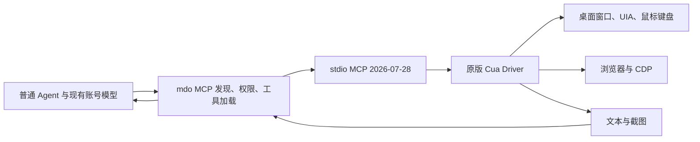

# Computer Use 使用与维护

当前实现将官方 Cua Driver 作为 mdo 的本机 MCP 服务。Windows x86_64 已部署，
Linux、macOS 保留同一 MCP 接口，通过后续平台模板扩展。驱动固定为官方 0.38.0，
没有修改 Cua，没有安装额外 Skill、系统提示词或自动重试逻辑。

## 在本开发目录运行

```powershell
Set-Location D:\GIT\mdo-computer-use
python -m computer_use run
```

这会打开本目录的 mdo 0.7.0，使用本目录的 `mdo-home`，开发端口为 5391。
在启动命令所在终端按 Ctrl+C 结束它。现有账号已在此 Home 中验证可用，
当前可用模型为 `ornith-1.5-35b`。会话保存在这个 Home，驱动按需启动。
不要将 `mdo-home` 作为插件的一部分分发。

选择支持图片输入和工具调用的模型，在普通对话中说明目标窗口与任务即可。
模型通过 mdo 的 `tool_search`、`tool_load` 按需发现原始 Cua 工具。
工具权限沿用 mdo 当前会话的权限设置；模板不会额外授予系统权限。
控制对象是运行 mdo 的设备，Web 页面访问者的电脑不会因此获得本地控制能力。

## 在另一台 Windows 设备安装

需要 Python 3.12+；从源码构建还需要 mdo 原有 Windows C 构建工具链和
`deps.lock` 指定的 XServer 源码对象。驱动安装不需要 Python 第三方依赖。
Python 用于本仓库的部署/验证命令；安装好程序与连接后，mdo 和 Cua 运行本身
不依赖 Python。

```powershell
python -m computer_use build --xserver-repository D:\GIT\xserver
python -m computer_use driver
python -m computer_use configure
python -m computer_use package
python -m computer_use install-template
```

`driver` 下载并校验固定的官方 ZIP 和其中全部六个文件；已有正确安装会直接复用。
可用 `--archive PATH` 复用已下载的官方 ZIP。安装路径为
`.build/computer-use/cua/0.38.0/`，须保留完整目录。
ZIP 约 34.23 MiB，解压后约 93.76 MiB；未安装可选模型或 perception 扩展。

`configure` 创建停用的设备连接。在 mdo「设置 → MCP」中启用并测试连接。
也可在 mdo 停止时明确执行：

```powershell
python -m computer_use configure --enable --replace
python -m computer_use run
```

该命令仅修改此开发 Home 中的 `cua-driver` 连接。`--replace` 会覆盖该连接的
现有参数，应在明确需要恢复本项目默认配置时使用。

默认「Windows 桌面」方案使用 Cua 标准权限，可使用普通桌面和临时浏览器工具。
附加已有登录的 Chrome/Edge 等 Chromium 配置时，Cua 还需要运行实例级授权。
在创建连接时明确选择「Windows 桌面及现有浏览器（显式授权）」方案，预览中会显示
官方参数 `--grant existing-profile`。授权范围是 Cua 的现有浏览器附加能力，
权限模式仍为 standard。mdo 的普通工具批准与这项授权分别生效。

命令行对应配置为（同样须在本目录 mdo 停止时执行）：

```powershell
python -m computer_use configure --enable --replace --grant-existing-profile
```

## 模板分发与扩展系统

生成的 `.build/computer-use/computer-use.mdo-extension.json` 是普通
`mdo.extension.v1` 包，包含一个 `mdo.mcp-template.v1` 服务模板。
它可以使用 mdo 原有扩展导入流程安装；未向线上商店发布。

模板只分发公开配置，不包含驱动、本机路径或账号信息。用户安装模板后，在
「设置 → MCP」选择已安装模板，创建连接并填写 `cua-driver.exe` 路径，预览参数，
确认信任该本机程序后保存，再启用并测试。连接与模板生命周期分离，连接默认停用。
开发目录的命令行配置与这个模板生成相同的 Cua 启动参数。



没有另建 Agent 框架、代理服务器或桌面 API。MCP 原始工具、说明和结构化结果
均由现有链路传递。宿主默认支持把一个不超过 1 MiB 的 MCP 图片结果交给模型；
超出或多图片场景需要单独验证，不能据此宣称全部媒体组合已支持。

接入时修复了 mdo 宿主的两个通用问题：动态工具目录引用提前释放，以及
Responses 多段工具结果丢失文本/图片。这些变更保存在现有 SDK overlay 和
`deps.lock`；Cua 的六个文件始终与官方哈希一致。没有改变 Cua 的窗口映射、
取消机制或 Agent 行为。

## 验证命令

请先关闭本目录正在运行的 mdo，再顺序执行。测试直接使用此目录、同一个 Home、
同一份 SDK 和已构建宿主，不创建 worktree 或应用副本。

```powershell
python -m computer_use smoke
python -m computer_use probe
python -m computer_use verify-template
python -m computer_use transport-check
python -m computer_use transport-check --scope browser-grant
python tests/test_computer_use_catalog.py
python tests/test_computer_use_responses.py
python -m unittest discover -s tests -p test_computer_use.py
python -m computer_use acceptance --scope desktop
python -m computer_use acceptance --scenario click
python -m computer_use acceptance --scope browser
```

需要明确对照协议时，可加 `--protocol anthropic-messages` 等 mdo 已支持的
会话协议参数。它只作用于新建的验收会话，不改变默认模型协议。

`transport-check` 是确定性原生传输测试；`acceptance` 才是实际账号模型自主操作。
后者消耗现有账号额度，不会把账号凭据写入代码或报告。
桌面测试仅操作专用 Win32 验收窗口。浏览器测试使用本机回环页面和临时测试浏览器，
不复制用户浏览器配置。测试结束清理自己启动的进程。

结果与覆盖写入的日志保存在 `.build/computer-use/`；完整会话仍在普通 Home 中。
构建回执记录源码 commit、是否有未提交修改、依赖锁与 overlay 摘要、产物 SHA-256。
根目录 `xs.json` 是命令生成的运行配置；测试之后用 `run` 重建应用运行配置。

当前实际结果、提交阶段和未通过项见 [验收记录](../COMPUTER_USE.md)。
普通工具调用成功、截图进入会话和模型完成任务是不同的验收条件。
当前默认 Responses 路径已通过独立的单击及读图真实闭环，耗时 172.62 秒。
完整表单和浏览器自主任务仍未通过，详见记录；确定性桌面/浏览器测试均通过。
现有浏览器授权检查仅操作本目录创建的空测试配置，验证未授权拒绝、明确授权后
输入与截图成功、断开不终止外部浏览器，最后清理此测试配置。

| 真实模型任务 | 协议 | 结果 | 耗时 |
| --- | --- | --- | --- |
| 单击及读取截图验证码 | Responses | 通过，点击一次且反馈图像正确 | 172.62 秒 |
| 完整表单 | Responses | `loop_guard`，未修改控件 | 184.11 秒 |
| 完整表单 | Chat Completions | 输入、按钮、复选框通过；整体超时 | 300.89 秒 |
| 完整表单 | Anthropic Messages | 首个模型请求超时，无工具调用 | 300.19 秒 |
| 浏览器完整表单 | Responses | 未完成，超时 | 301.16 秒 |

上述均使用现有账号的 `ornith-1.5-35b`，不包含补充指令或自动重试策略。
63 项表示官方工具 schema 均可加载，本轮未逐一执行录屏、可选 perception 等
全部工具；其依赖、许可及设备能力继续遵循 Cua 本身的约定。

## 升级与跨平台

- Cua 升级：显式更新 `cua-driver.lock.json` 的版本、来源与全部校验值，检查
  原始工具协议和描述，再顺序运行上述验证。当前不会自动覆盖固定版本。
- Linux：新增官方 Linux 产物锁和模板变体，验证桌面会话、显示服务器及输入/截图权限。
  Agent 与 mdo MCP 调用接口继续复用。
- macOS：新增官方 app/daemon 启动方案及 Accessibility、Screen Recording 授权流程，
  按官方平台方式接入，不直接照搬 Windows 的 `mcp --direct` 参数。
- 新平台通过实际验收后再加入模板平台声明。当前 Windows 模板没有把其他平台标为可用。

上游参考：[Cua Driver 0.38.0 源码与平台说明](https://github.com/trycua/cua/tree/cua-driver-rs-v0.38.0/libs/cua-driver)。
mdo 扩展约定见 [扩展系统](extensions.md)、[MCP 服务模板](mcp-service-templates.md)。
